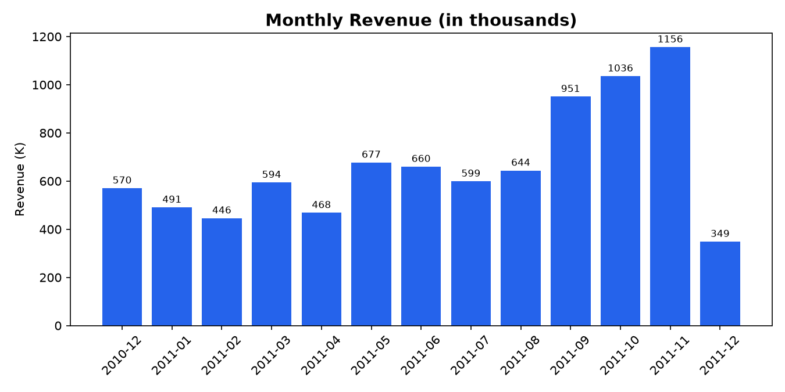
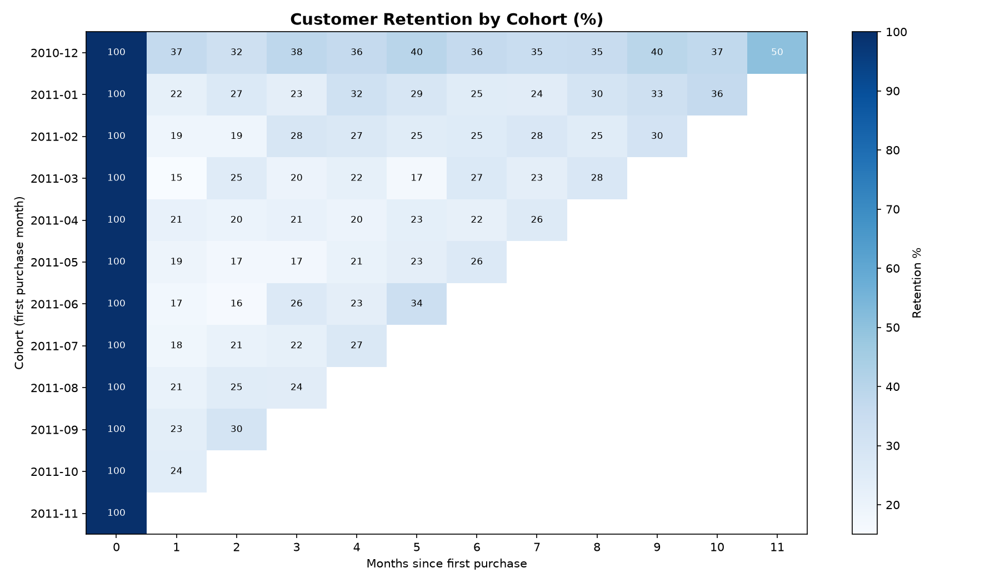

# E-commerce Customer Retention & Sales Analysis (SQL + Python)

Analysis of a UK online store's transactions (Dec 2010 to Dec 2011) to understand sales trends, top markets and products, and, most importantly, **how many customers come back** using cohort analysis.

## Business Questions
1. How did revenue change month by month?
2. Which countries and products earn the most revenue?
3. How many customers are repeat buyers?
4. Of the customers who first bought in a given month, what percentage come back in later months? (cohort retention)

## Tools Used
- **Python (pandas, matplotlib):** cleaning and charts
- **SQL (SQLite):** aggregation, CTEs, window functions, joins, cohort query
- **Jupyter Notebook:** analysis workflow

## Data
Online Retail dataset: 541,909 transaction rows with invoice, product, quantity, date, price, customer ID and country. Not included in this repository because of file size; download "E-Commerce Data" (Online Retail) from Kaggle and place `data.csv` next to the notebook.

## Data Cleaning
| Step | Rows left |
|---|---|
| Raw data | 541,909 |
| Removed rows without CustomerID (135,080) | 406,829 |
| Removed cancelled invoices (start with "C") | 397,924 |
| Removed zero or negative quantity and price | 397,884 |
| Removed exact duplicates | 392,692 |
| Removed 2 large orders (74,215 and 80,995 units) that were cancelled minutes later | **392,690** |

Final data: **4,337 customers, 18,530 orders, about 8.64M in revenue.** December 2011 is excluded from the cohort analysis because the data ends on 9 December.

## Key Findings
| Question | Result |
|---|---|
| Revenue trend | Revenue peaks in **Sep to Nov 2011**: 951K, 1,036K and 1,156K |
| Top country | **United Kingdom: 81.5%** of revenue, then Netherlands (3.3%), EIRE (3.1%), Germany (2.6%) |
| Top product | **Regency Cakestand 3 Tier** (142K), then White Hanging Heart T-Light Holder (100K) |
| Repeat customers | **65.6%** of customers bought more than once and generate **93.8%** of revenue |
| Cohort retention | On average **21.5%** of customers return the next month, **24.6%** after 3 months, **26.9%** after 6 months |

**Cohort highlights**
- The **December 2010 cohort** is the most loyal: 36.6% returned in month 1 and 50% were still active in Nov 2011
- Retention does not fall to zero after month 1; it settles around 20 to 27%, so customers who return tend to keep returning
- Nearly every cohort shows a jump in retention in Nov 2011, suggesting a seasonal effect

## Charts

## Recommendations
1. **Target new customers within 30 days of their first purchase.** About 4 in 5 never return after the first month, so an early follow-up offer has the biggest upside.
2. **Protect repeat customers.** They are about 2 in 3 customers but nearly all of the revenue.
3. **Prepare stock and campaigns before September.** Revenue and returning customers both rise sharply from September to November.

## Files
- `ecommerce_cohort_analysis.ipynb`: full analysis (cleaning, SQL queries, charts)
- `chart_monthly_revenue.png`, `chart_cohort.png`: charts
